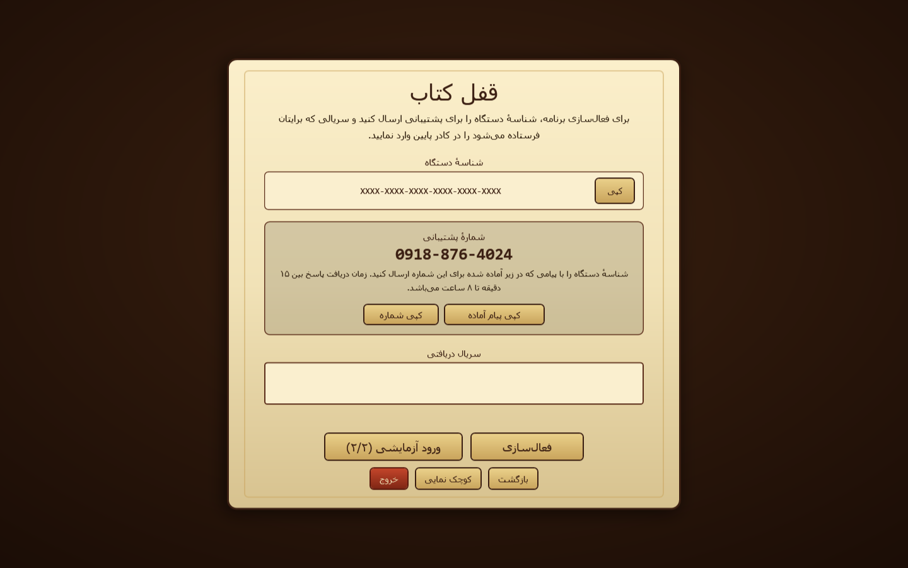
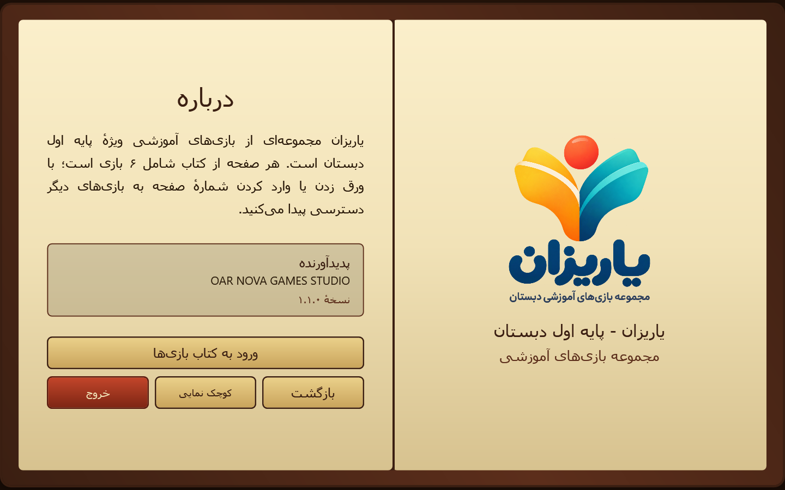
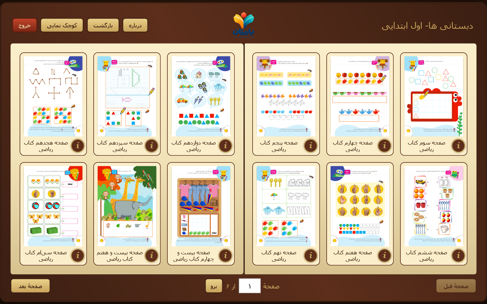
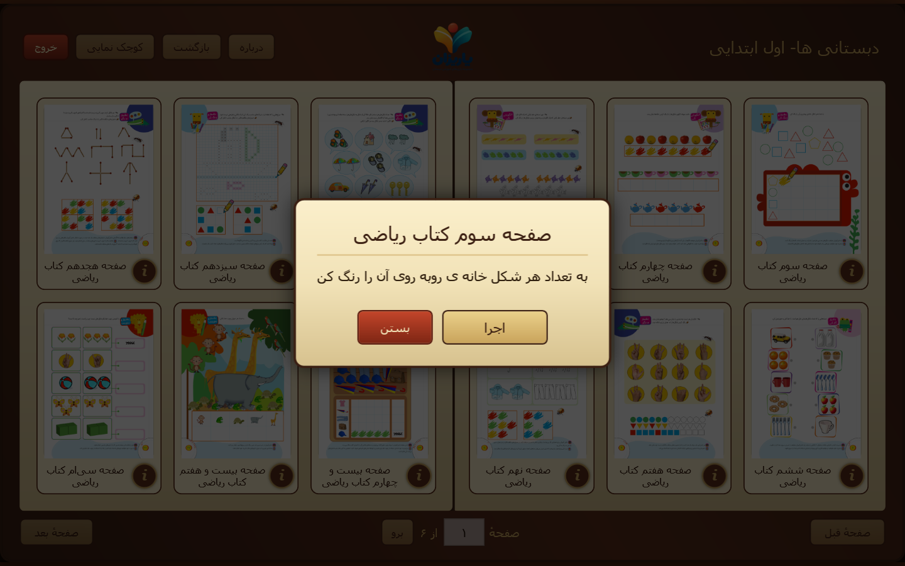
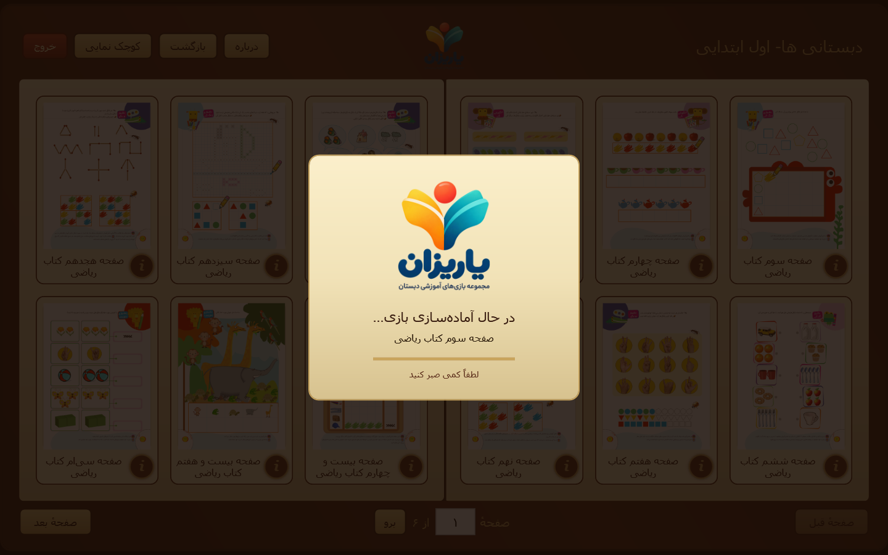
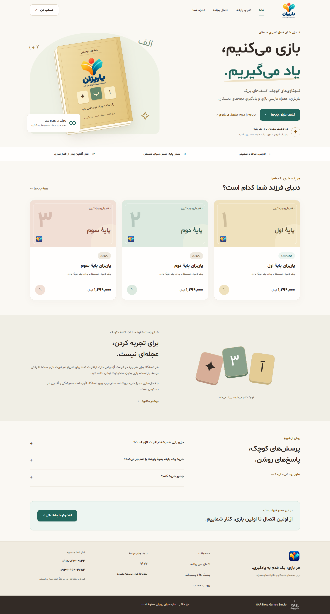
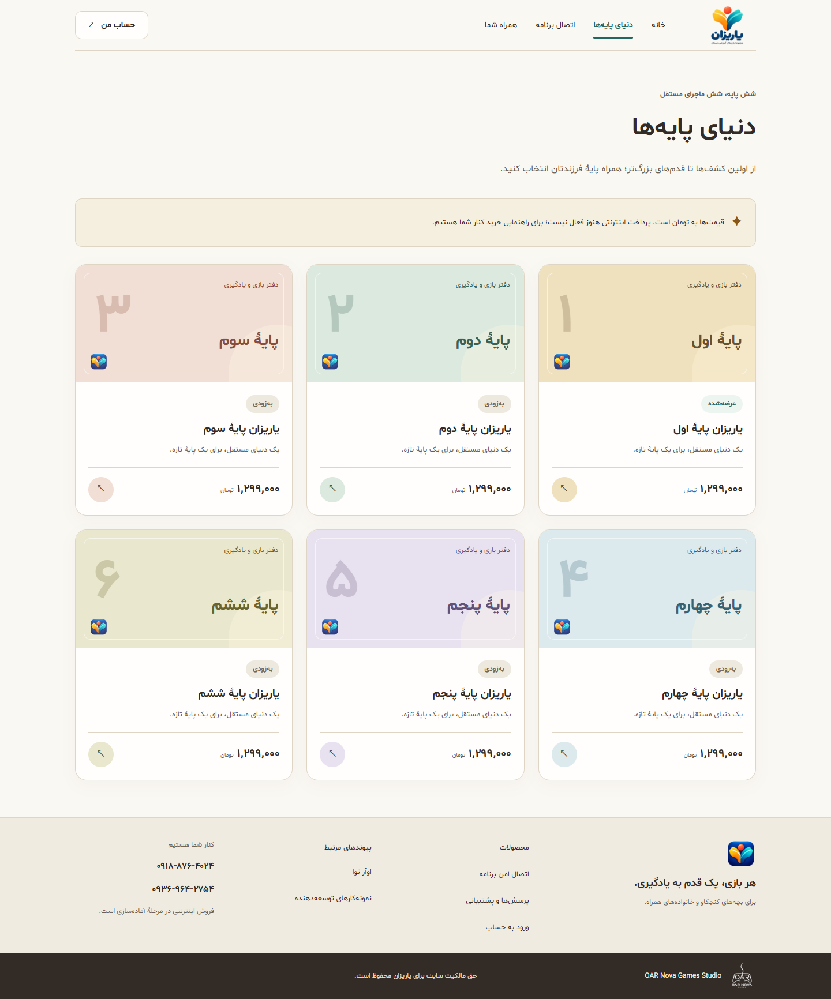
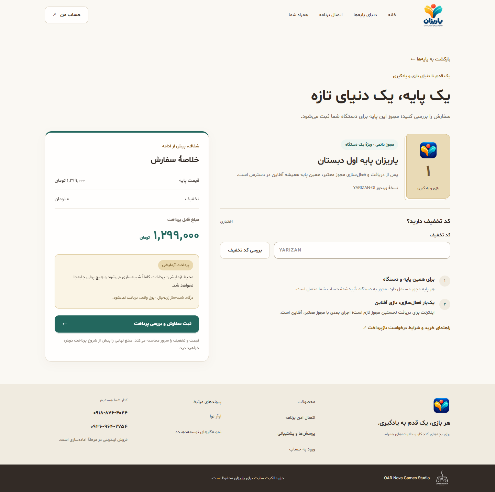
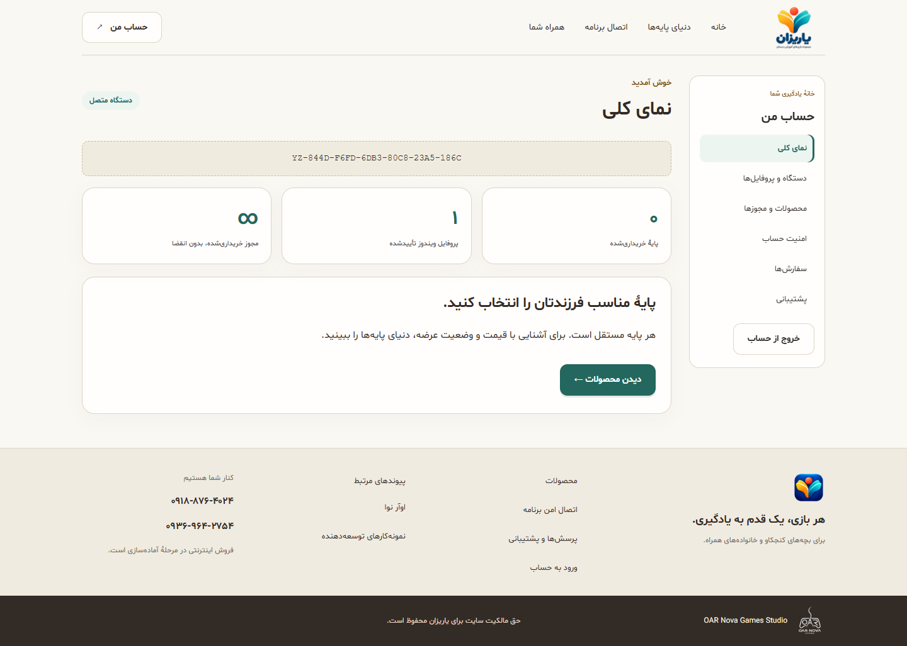
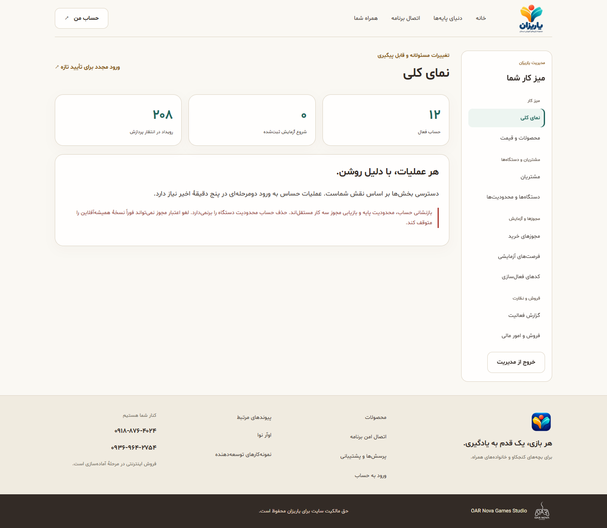

<div align="center">


# YariZan — یاریزان

Grade-specific Persian RTL educational mini-game launcher by **OAR NOVA GAMES STUDIO** for Windows, with a book interface, encrypted game bundles, and a PHP/MySQL licensing panel.
</div>

## App features

Download the Windows installer or the ZIP containing the installer and its SHA-256 checksum from [release 1.1.0](https://github.com/osameh15/YariZan/releases/tag/1.1.0).

- One grade per package, named **YariZan G1**, **G2**, etc.; the Persian cover title follows the selected grade.
- Portrait game artwork in three columns and two rows per page, with book page-turn animation.
- Direct page navigation using Persian, Arabic, or English digits.
- Game titles come from filenames; descriptions show instructions without repeating the title.
- Animated YariZan-logo loading while a selected game is prepared and opened. Background preparation keeps the interface responsive and prevents duplicate launches.

## Screenshots

Fresh captures of the current WPF views using the local G1 catalog. Activation/trial screens illustrate UI states; device identifiers are masked. Click an image to open it at full resolution.

<table>
  <tr><th>Cover and studio branding</th><th>Activation and trial</th></tr>
  <tr>
    <td><a href="docs/Images/cover-page.png"></a></td>
    <td><a href="docs/Images/lock-page.png"></a></td>
  </tr>
  <tr><th>Information and credits</th><th>Portrait game book</th></tr>
  <tr>
    <td><a href="docs/Images/info-page.png"></a></td>
    <td><a href="docs/Images/game-book.png"></a></td>
  </tr>
  <tr><th>Game details</th><th>Game-start loading</th></tr>
  <tr>
    <td><a href="docs/Images/game-detail.png"></a></td>
    <td><a href="docs/Images/game-loading.png"></a></td>
  </tr>
</table>

<table>
  <tr><th>Web storefront</th><th>Catalog</th></tr>
  <tr>
    <td><a href="docs/Images/web/home.png"></a></td>
    <td><a href="docs/Images/web/catalog.png"></a></td>
  </tr>
  <tr><th>Checkout</th><th>Customer dashboard</th></tr>
  <tr>
    <td><a href="docs/Images/web/checkout.png"></a></td>
    <td><a href="docs/Images/web/customer-dashboard.png"></a></td>
  </tr>
  <tr><th>Admin dashboard</th><th></th></tr>
  <tr>
    <td><a href="docs/Images/web/admin-dashboard.png"></a></td>
    <td></td>
  </tr>
</table>

Regenerate the images with `powershell -NoProfile -ExecutionPolicy Bypass -File tools/Capture-AppScreenshots.ps1` after packing the local catalog. See [screenshot notes](docs/Images/README.md).

## V2 Phase 1 desktop foundations (feature branch; review required)

Desktop access now uses a shared versioned device username, grade-bound signed perpetual offline licenses and online-to-start trials. Active trials have no heartbeat, per-game authorization or expiry. Paid sync is asynchronous; revocation affects the next launch. See [Phase 1 report](docs/YARIZAN-PHASE-1-REPORT.md) and [artifact profile](docs/adr/0004-phase-1-desktop-artifact-profile.md).

**Not release-ready:** secure NestJS enrollment/credential issuance and production public-key provisioning are blocked. The stock build grants no access through test keys or legacy PHP. Tests inject disposable trust roots and a transactional fake server. Run `tests/Run-V2Checks.ps1` on Windows with .NET 9 runtime and Node. Close the report's release gates before distribution.

## Approved V2 platform target (backend not implemented)

Phase 2 backend core is now available for isolated development and review under [`backend/`](backend/README.md). See the [Phase 2 report](docs/YARIZAN-PHASE-2-REPORT.md), [implemented API snapshot](docs/YARIZAN-OPENAPI-BACKEND-V2.json) and [ADR-0005](docs/adr/0005-backend-enrollment-and-transaction-authority.md). Production startup and the stock desktop commercial enrollment gate remain closed; no checkout, SMS or deployment is implemented. The older design status text below is historical context.

Commercial YariZan V2 will use a Nuxt 4 storefront/customer/Admin portal, NestJS/PostgreSQL backend, per-device common customer username, six independent grade entitlements, ZarinPal checkout, discount campaigns, and **per-product perpetual offline paid licenses**. Two trial entries **per device and grade** require internet **only to start each trial process session**; once entered, an open trial process continues without internet or a heartbeat. Password-based onboarding uses confirmed device pairing; MeliPayamak is planned for a later reset-link stage. **Phase 1 desktop foundations are under review; no V2 backend, database or deployment has been shipped.** Refer to the [V2 specification](docs/YARIZAN-TECHNICAL-SPEC-V2.md), [data model](docs/YARIZAN-DATA-MODEL-V2.md), [API contracts](docs/YARIZAN-API-CONTRACTS-V2.md), and [roadmap](docs/YARIZAN-IMPLEMENTATION-ROADMAP-V2.md).

### Phase 0 security and implementation handoff (design baseline; untested)

- [Phase 0 baseline and readiness gates](docs/YARIZAN-PHASE-0-BASELINE.md)
- [Architecture decisions — device, license/trial, commerce](docs/adr/0001-device-identity-and-account-claim.md)
- [Threat model and security acceptance](docs/YARIZAN-THREAT-MODEL-V2.md)
- [Machine-readable design OpenAPI](docs/YARIZAN-OPENAPI-V2.yaml)
- [Phase 1 desktop implementation agent brief](docs/YARIZAN-PHASE-1-AGENT-BRIEF.md)

## Historical access policy (legacy 1.1.0 release only)

The cover appears first on every launch. Opening the book requires internet: the app validates the saved paid serial or shows the activation/trial screen. New devices register their HWID and PC name with two trial entries; viewing status does not consume an entry. Only pressing the trial entry button consumes one.

Paid and trial sessions check access before each game launch and every 60 seconds. Connection failures return to Lock and stop games launched by the app. Reconnecting and pressing Retry automatically validates a saved paid serial; users do not enter it again after an ordinary outage. Removing a device blocks it; regenerating its serial invalidates the old serial. Trial counts are stored in MySQL and reset from the panel.

## Start here

Run commands from the repository root in Windows PowerShell. Use a .NET SDK that builds `net9.0-windows`; workflows use .NET 9. Install Inno Setup 6 or 7 for installer builds. PHP 8.2+ and MySQL/InnoDB run the licensing service.

1. Restore the existing `secrets/private.pem`, `secrets/public.pem`, and `secrets/master.key` from your secure backup. For a completely new product key set, follow [key setup](docs/build-and-pack.md#keys).
2. Add local games following [miniApps/README.md](miniApps/README.md). The public repository contains no game payloads or private configuration.
3. Set up licensing using [the hosting guide](web/licensing/README.md). Compilation can succeed without the service; protected access cannot.
4. Pack, build, and run:

```powershell
dotnet restore src/YariZan.sln
dotnet run --project src/YariZan.Packer
dotnet build src/YariZan.sln -c Release
dotnet run --project src/YariZan.App
```

The grade is detected automatically from the only source folder containing games. Empty folders are ignored; with several populated grades, pass `--grade 2` (or another grade) to both packer and installer builder. Each package contains one grade and is named **YariZan G1**, **YariZan G2**, etc. The book uses portrait tiles and an editable page number.

Create the setup executable:

```powershell
.\build-installer.bat --noninteractive
```

| Output | Use |
|---|---|
| `publish/YariZan-G1-win-x64/YariZan-G1.exe` | Self-contained launcher; keep adjacent `games_encrypted/` |
| `publish/YariZan-G1-Setup-v1.1.0.exe` | Installer containing launcher and games |
| `publish/YariZan-G1-Setup-v1.1.0.exe.sha256` | Installer SHA-256 checksum |
| `publish/YariZan-G1-Setup-v1.1.0.zip` | Installer and its checksum in one download |
| `publish/installer-about.rtf` | Generated build input; disposable after compilation |

If the standard publish directory already exists, the builder preserves it and prints the new directory with a build suffix.

See [build-and-pack.md](docs/build-and-pack.md) for portable publishing, installer options, troubleshooting, and release checks. Never distribute source games, keys, private hosting ZIPs, or credentials with a release.

## Operator workflow

Log in to `https://yarizan.osameh.dev/` using private admin credentials. Search by name, description, HWID, or serial; use Add with HWID if needed. Edit name/description and generate the serial once. Copy it to the customer. Metadata edits retain it. Regenerate issues a replacement, Reset trial restores two entries, and Remove blocks the HWID. Styled confirmation dialogs protect these actions.

The current serial can reactivate after an OS reinstall only if the HWID matches. Hardware/WMI changes can alter it. Uninstall retains saved activation and never resets server trials.

## Repository map

| Path | Responsibility |
|---|---|
| `src/YariZan.App/` | WPF views, online client, branding/fonts |
| `src/YariZan.Core/` | HWID, crypto, activation/session state, games and sorting |
| `src/YariZan.Packer/` | Encrypts local games and writes manifest |
| `src/YariZan.SerialGen/` | Key setup/diagnostics; customer serials come from panel |
| `web/licensing/` | Public panel/API and private implementation/schema |
| `miniApps/` | Ignored local games directly in grade folders `1`–`6` |
| `games_encrypted/` | Ignored generated catalog; README tracked |
| `secrets/` | Keys; private/master keys ignored |
| `tools/`, `tests/` | Packaging/deployment and isolated checks |
| `docs/Images/`, `docs/YariZan_Brand_Kit_v1/` | App screenshots, supplied images and original brand resources |
| `publish/` | Ignored app, installer, upload bundles |

## Documentation

| Guide | Contents |
|---|---|
| [Phase 0 baseline](docs/YARIZAN-PHASE-0-BASELINE.md) | ADRs, threat model, verification gates; not runtime-tested |
| [Phase 1 implementation brief](docs/YARIZAN-PHASE-1-AGENT-BRIEF.md) | Reviewable desktop-only agent scope |
| [V2 design OpenAPI](docs/YARIZAN-OPENAPI-V2.yaml) | Pre-implementation API schema baseline, needs lint |
| [V2 threat model](docs/YARIZAN-THREAT-MODEL-V2.md) | Assets, attack boundaries, expected tests |
| [V2 commercial specification](docs/YARIZAN-TECHNICAL-SPEC-V2.md) | Approved target behavior; **not yet implemented** |
| [V2 database model](docs/YARIZAN-DATA-MODEL-V2.md) | PostgreSQL entities and concurrency invariants |
| [V2 HTTP contracts](docs/YARIZAN-API-CONTRACTS-V2.md) | API, offline license and trial contracts |
| [V2 delivery roadmap](docs/YARIZAN-IMPLEMENTATION-ROADMAP-V2.md) | Engineering phases and acceptance gates |
| [Build and pack](docs/build-and-pack.md) | Setup, keys, games, portable EXE, installer, cleanup |
| [Hosting and panel](web/licensing/README.md) | Database, private files, admin, FTP/CDN, deployment, API |
| [Architecture](docs/architecture.md) | Modules/runtime flow |
| [Security](docs/security.md) | Signed access, revocation, limitations |
| [UI flow](docs/ui-flow.md) | Screens, retry and modals |
| [CI](docs/ci.md) | Checks, secrets, public-only deployment |
| [Licensing decisions](docs/online-licensing-plan.md) | Current policy and future improvements |

## License and contact

Proprietary; see [LICENSE.txt](LICENSE.txt) for the bilingual EULA. Game/font distribution must respect their respective licenses. Local encryption and signed checks do not make a customer-controlled binary impossible to modify; see [security limits](docs/security.md#limitations).

Website: [osameh.dev](https://osameh.dev) · Support: [support@osameh.dev](mailto:support@osameh.dev) · Telegram: [@osameh_ir](https://t.me/osameh_ir)

## V2 Phase 3 web and provisioning review

The isolated [Nuxt 4 storefront and portals](apps/web/README.md) use the real NestJS/PostgreSQL contracts. Browser pairing returns only an approval receipt; a fresh Windows CNG proof picks up enrollment and the short-lived credential. See [ADR-0006](docs/adr/0006-web-and-desktop-provisioning.md), [Phase 3 engineering report](docs/YARIZAN-PHASE-3-REPORT.md), and [web screenshots](docs/Images/web/). Commercial startup remains closed. Payments and deployment are not implemented or authorized; SMS authentication is implemented for review with a fake local provider and a gated vendor adapter. Existing legacy services remain separate.

## Phase 3.1 authentication, UX, SMS and notes

The same Draft PR includes mobile OTP first claim/login/reset, optional passwords and mobile management, SMS Admin MFA, shared Persian validation, and revisioned searchable internal notes. [Auth/SMS contracts](docs/YARIZAN-AUTH-AND-SMS-CONTRACTS.md) and the [Phase 3.1 report](docs/YARIZAN-PHASE-3-1-REPORT.md) distinguish tested local behavior from missing live provider credentials/template and commercial ownership/signing gates. Desktop credential pickup remains desktop-only; paid/trial offline guarantees are unchanged.


## V2 Phase 4 synthetic commerce review

[Phase 4 report](docs/YARIZAN-PHASE-4-REPORT.md), [commerce contracts](docs/YARIZAN-COMMERCE-CONTRACTS.md) and [web screenshots](docs/Images/web/) cover authoritative orders/coupons, a labeled payment simulator, durable reconciliation, exactly-once perpetual license fulfillment and customer/Admin finance pages. Existing PostgreSQL commerce tables are extended by migration 009. Enable COMMERCE_MODE=fake only for isolated development; disabled remains the default. Real ZarinPal selection and production startup refuse to run. No live charge, refund, SMS or deployment is authorized; commercial [release gates](docs/YARIZAN-COMMERCIAL-RELEASE-CHECKLIST.md) remain closed.
