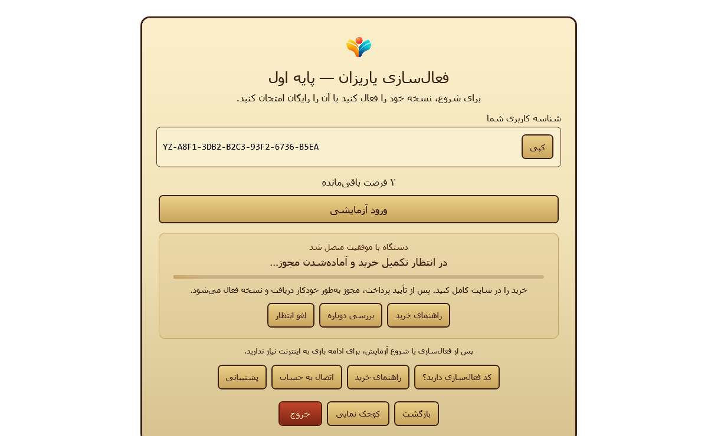

# YariZan V2 — Automatic Desktop License Activation

| Item | Value |
| --- | --- |
| Branch | `feat/yarizan-v2-auto-license-activation` |
| Base | `main@30ffa0580f6f743ee4d5241585b584d1dad6ef1a` (PR #4 merge) |
| Final HEAD | see the Draft PR (this document is committed in it) |
| Draft PR | see §12 |
| Scope | Windows desktop only. Separate from Production Readiness PR #5 (release pipeline). |

**Summary.** The desktop now waits automatically for a purchased license once it is connected to an account. When the backend has fulfilled the purchase, the app picks up the signed license, verifies it, stores it with DPAPI and enters the game library without another click. A locally verified paid license opens the library at launch with no network call. An enrolled device without a license makes one bounded pickup check at launch, so a purchase completed while the app was closed activates on the next start. No backend route, signed-artifact field or commercial gate changed. Nothing was merged, published or deployed.

## 1. Verified starting behavior

Checked against `main@30ffa05` before any change:

1. `MainWindow.Loaded` always called `ShowCover()`, even with a valid cached paid license. Confirmed.
2. Pairing approval was polled (`LockPage.Connect_Click`, 5 s loop); paid license availability was not. Confirmed.
3. After payment the customer had to click «فعال‌سازی نسخه», which ran one `PickupLicenseAsync`. Confirmed.
4. The backend already exposed device-authenticated `GET /api/v2/desktop/entitlements` (`[{sku,state}]` for the device and current generation) and `POST /api/v2/desktop/licenses/pickup` (idempotent, signed license). Confirmed in `backend/src/api/controllers.ts` and `backend/src/licenses/licenses.ts`.
5. Commercial public-key and build gates are closed: the stock build has no reviewed roots, so `Provisioning` is null and no device can enroll. Unchanged.

## 2. Source changes

| File | Change |
| --- | --- |
| `src/YariZan.Core/V2/DesktopV2Client.cs` | `GetEntitlementsAsync` (strict parse: array ≤ 64, fields exactly `sku`,`state`, known SKU, state in `ACTIVE/REVOKED/RESET`). `V2ApiException.RetryAfter` from the `Retry-After` header, clamped to 1–900 s. |
| `src/YariZan.Core/V2/DesktopAccessController.cs` | `CheckPurchasedLicenseAsync`: one serialized attempt (entitlement lookup, then pickup, verify, durable store). `HasLocalEnrollment`. `AdoptStoredLicense` (accepts a license another process of the same profile already verified and stored). `IDesktopV2Client` gains `GetEntitlementsAsync`. |
| `src/YariZan.Core/V2/PaidActivation.cs` (new) | `PaidActivationCoordinator` (scheduling, cancellation, backoff, phases), `PaidActivationTiming`, `IActivationIntentStore` with file and memory implementations. |
| `src/YariZan.App/Views/MainWindow.xaml.cs` | Launch routing, single navigation point after activation, coordinator lifetime. |
| `src/YariZan.App/Views/LockPage.xaml(.cs)` | Automatic-activation panel (status, progress, actions), automatic wait after pairing, «فعال‌سازی نسخه» starts the wait. |
| `src/YariZan.App/Services/DesktopAccessFactory.cs` | Creates the per-profile wait marker store. |
| Tests | `tests/V2Checks/AutoActivationChecks.cs`, `AutoActivationUiChecks.cs` (new); `Fixtures.cs`, `Program.cs`, `LockDialogChecks.cs`; `tests/BackendInterop/ProvisioningTransportChecks.cs` and `.csproj`. |

`DesktopAccessController` remains the only local access authority. The coordinator never sets access; it only calls the controller.

## 3. Startup and navigation state machine

```
Launch
 ├─ controller.IsPurchased (local signed license + decision verified, no network)  ──► Game library
 │      background SynchronizePurchasedAsync (never blocks, revocation applies next launch)
 ├─ enrolled AND not locally revoked AND wait marker present ──► Lock, automatic wait resumes
 ├─ enrolled AND not locally revoked ──► Cover + one bounded startup check (20 s deadline)
 │      ├─ ACTIVATED ──► Game library (Lock never shown)
 │      └─ waiting / network / any other result ──► stays on Cover; Lock shows normal choices
 └─ otherwise (not enrolled, revoked, invalid) ──► Cover, existing Lock behavior
```

Coordinator phases (`PaidActivationPhase`) and the requested names:

| Requested | Implemented | Meaning |
| --- | --- | --- |
| LOCAL_PAID_VALID | `DesktopAccessState.Purchased` at construction | Controller verified the cached license; coordinator not used |
| ENROLLMENT_REQUIRED | `EnrollmentRequired` | No verified local enrollment or 401 |
| PAIRING_PENDING | Lock pairing dialog (existing) | Key-proof pairing until browser approval |
| ENROLLED_WAITING_PURCHASE + FULFILLMENT_PENDING | `WaitingForPurchase` | No ACTIVE entitlement yet, or pickup answered `ENTITLEMENT_REQUIRED` |
| (check in flight) | `Checking` | One request sequence in progress |
| LICENSE_PICKUP_PENDING | `RetrievingLicense` | ACTIVE entitlement seen; signed pickup in progress |
| ACTIVATED | `Activated` | Signed license verified **and** stored |
| NETWORK_UNAVAILABLE | `NetworkUnavailable`, `RateLimited` | Temporary; retried with backoff |
| PRODUCT_BLOCKED | `ProductBlocked`, `ProductUnavailable` | Stops waiting |
| LICENSE_REVOKED | `LicenseRevoked` | Local signed revocation, REVOKED entitlement or `LICENSE_REVOKED` pickup; stops |
| INVALID_LICENSE | `InvalidLicense` | Pickup body failed verification; stops, nothing stored |
| CANCELLED | `Cancelled`, `Paused` | Customer cancelled, page left, or 30-minute budget reached |
| — | `AccountRestricted` | `ACCOUNT_RESTRICTED`; stops |

Why the two waiting states are merged: payment fulfillment creates the entitlement and the signed license in one transaction (`backend/src/commerce/payments.ts`). Until then the device-scoped API has nothing to report, so "not paid yet" and "paid, fulfillment pending" are indistinguishable without exposing order data to the desktop. Both mean "keep waiting", and the customer-facing message covers both. No new endpoint was added (requirement I).

## 4. Pairing-to-payment sequence

1. Lock → «اتصال به حساب» → key-proof pairing (`DesktopProvisioningClient.BeginAsync`); dialog shows «در حال اتصال امن دستگاه…».
2. Browser approval and mobile OTP on the website (unchanged).
3. Desktop polls `CompleteAsync` with a fresh CONFIRM proof; enrollment is verified and stored with DPAPI (unchanged).
4. Dialog closes; `ReloadProvisionedIdentityAsync`, trial status refresh; the activation panel appears with «دستگاه با موفقیت متصل شد» and starts the wait. No click.
5. Each attempt: `GET desktop/entitlements` (bearer renewed through CNG AUTH proof when needed). No ACTIVE row for this SKU → «در انتظار تکمیل خرید و آماده‌شدن مجوز…».
6. Customer pays on the website; backend verifies the payment and fulfills it exactly once (unchanged).
7. Next attempt sees ACTIVE → «مجوز آماده است؛ در حال فعال‌سازی…» → `POST desktop/licenses/pickup`.
8. `AcceptPickedUpLicense`: signature, trusted key ID, domain, device UUID, fingerprint, grade/SKU, license revision, retained decision conflict; then DPAPI write (`WriteThrough` + flush + atomic replace).
9. Only then `Activated`: «نسخه شما فعال شد» (1.6 s), «در حال ورود به بازی‌ها…», then the game library. No game is launched.

## 5. Polling and cancellation

| Parameter | Value |
| --- | --- |
| Interval while waiting | 10 s for the first 6 checks, then 15 s, plus 0–3 s jitter |
| Network/5xx/timeout backoff | 10, 20, 40, 60 s (cap) plus jitter |
| 429 | `Retry-After` (clamped 1–900 s) as a floor, default 60 s. The current backend sends no header; its bucket is 120 requests per device per minute |
| Per-attempt deadline | 30 s (each HTTP request also has the client's 15 s timeout) |
| Startup check | one attempt, 20 s deadline |
| Wait budget | 30 min, then `Paused` with «بررسی دوباره» |
| Concurrency | one session per coordinator; one request sequence per controller (`_operation` semaphore); repeated triggers join the running session |

- Polling runs only while the Lock page shows the wait, or during the single startup check owned by `MainWindow`. Leaving the page stops it and keeps the customer's intent; «لغو انتظار» stops it and clears the intent.
- Window close disposes the coordinator before the controller: the session token is cancelled, a generation counter discards late results and events are detached. A response arriving afterwards changes nothing and triggers no pickup or navigation (tested).
- The desktop never contacts the payment provider and never reads browser checkout state, query strings or local flags as proof of payment.
- Multiple app instances of the same profile: each attempt first adopts a license that another instance already stored, so only one instance normally performs the pickup. No cross-process lock was added; pickup is idempotent on the server.

## 6. Restart, crash and offline behavior

| Case | Behavior | Evidence |
| --- | --- | --- |
| 1. License already stored | Library at once, no network, no Lock page, background sync only | WPF check with transport offline: zero entitlement, pickup, status and trial requests; separate OS process accepts the DPAPI store offline |
| 2. Paid while closed | Cover, one bounded check, pickup, store, library; Lock never shown | WPF check records every page shown; real-backend interop with an empty store |
| 2b. Customer was waiting when the app closed | Lock opens in the waiting state and continues | WPF check |
| 3. Closed during activation | Token cancelled, no callback, nothing stored, existing files untouched. The wait marker (a timestamp file, not a payment status) may remain so the wait resumes | WPF check |
| 4. Offline, no stored license | Fails closed; Lock: «ارتباط با سرور برقرار نشد. برای فعال‌سازی اولیه یا شروع آزمایش به اینترنت نیاز دارید.»; waiting panel: «برای فعال‌سازی اولیه به اینترنت نیاز دارید…» | WPF check, screenshot 09 and 10 |
| Cached signed revocation | Enforced at launch; automatic activation makes no request and cannot clear it; recovery stays the explicit authenticated decision path behind «فعال‌سازی نسخه» | Core and WPF checks |

The wait marker `%LOCALAPPDATA%\OARNOVA\YariZan\V2\YARIZAN-G<n>.awaiting-purchase` holds only a UTC timestamp, expires after 7 days, and is never read by access policy.

## 7. Trial behavior (unchanged)

Waiting and startup checks never call trial status or trial start. A pending or failed paid check never changes `TrialStarted`; a successful pickup upgrades it to `Purchased`; a later trial refresh cannot overwrite a purchase. No trial grant is persisted. The trial button stays available during the wait. All existing trial checks still pass.

## 8. Security invariants

- Only a signed perpetual license verified against the embedded trusted roots and bound to this device, fingerprint, profile enrollment and grade unlocks a purchased grade. An entitlement row, HTTP 200, unsigned JSON or a wait marker never does (tested for each).
- Access changes only after durable storage.
- Transport errors, timeouts, proxy pages and malformed bodies are temporary (`NetworkUnavailable`) and never invalidate a stored license or create a revocation.
- Revoked, blocked, restricted, unenrolled and invalid outcomes stop waiting instead of retrying into a different answer.
- No different-license-ID replacement: the existing retained-decision check in `AcceptPickedUpLicense` applies.
- No new endpoint, no browser-proxy exposure, no unauthenticated status route, no signing material, no root fallback, no gate change.

## 9. API changes

None. The desktop now calls the existing `GET /api/v2/desktop/entitlements`, already in `docs/YARIZAN-OPENAPI-BACKEND-V2.json` and `docs/YARIZAN-API-CONTRACTS-V2.md`, behind the same device bearer as pickup. The infrastructure desktop-route list is unaffected because no route was added. In Stage A every `/api/*` path is still answered by the brochure web with 503, so automatic activation is not operational there and was not tested against the public hostname.

## 10. Screenshots

Real WPF pages rendered off-screen by the test harness with synthetic fixtures (`publish/v2-checks/auto-activation/`, curated copies in `docs/Images/auto-activation/`). The pairing code is masked. They are not physical-display captures.

| # | State | File |
| --- | --- | --- |
| 1 | Pairing in progress | `01-pairing-in-progress.png` |
| 2, 4 | Pairing completed; checking purchased entitlement (same frame) | `02-pairing-completed.png` |
| 3 | Waiting for purchase | `03-waiting-for-purchase.png` |
| 5 | Retrieving signed license | `05-retrieving-signed-license.png` |
| 6 | Activation complete | `06-activation-complete.png` |
| 7, 8 | Automatic entry to game selection; restart with cached paid license offline (identical frame; synthetic empty library) | `07-automatic-game-selection.png` |
| 9 | Restart unpaid and offline | `09-restart-unpaid-offline.png` |
| 10 | Recoverable network failure | `10-recoverable-network-failure.png` |
| Small | 800×600 window | `03-waiting-for-purchase-800x600.png` |
| High DPI | 811×519 logical window rendered at 144 DPI (150%) | `03-waiting-for-purchase-150pct.png` |



## 11. Tests

Commands (Windows 11 10.0.26300, .NET 9.0.20, Node 24):

```powershell
.\tests\Run-V2Checks.ps1        # 387 passed, 0 failed (was 300 on main)
# backend, disposable local PostgreSQL 17 (docker compose up -d db), NODE_ENV=test,
# DATABASE_URL=...127.0.0.1:55432/yarizan_phase2_test and the synthetic CI HMAC keys
cd backend; npm run build; npm test   # 158 passed, 0 failed
```

The backend run includes the real C# checks: `DOTNET_INTEROP 24`, `DOTNET_API 10`, `DOTNET_PROVISIONING 29` (portable) and `30` (Windows CNG + DPAPI). The provisioning checks now also prove, against the real API and the synthetic payment simulator: entitlement lookup before purchase waits without access; a waiting coordinator picks up the verified purchase automatically; a relaunch with an empty license store recovers the signed license at startup.

Local note: Claude Code sets `NoDefaultCurrentDirectoryInExePath=1`, which makes the existing installer-preflight check fail locally (`cmd` cannot find `build-installer.bat` in the current directory). The suite was run with that variable removed; CI is unaffected.

Required scenarios:

| # | Scenario | Where |
| --- | --- | --- |
| 1 | Pairing approved, no purchase: waiting UI | WPF first-purchase check |
| 2 | Purchase verified after delay | Core (virtual time) + WPF + real backend |
| 3 | Payment pending for several polls | Core (8 polls) + WPF |
| 4 | Fulfillment delayed after payment | Core (pickup `ENTITLEMENT_REQUIRED` twice) |
| 5 | Window closed while polling | WPF |
| 6 | Restart after payment, before pickup | WPF + real backend |
| 7 | Restart after pickup | Core + WPF |
| 8 | Offline start with paid license | WPF (zero requests) + separate OS process |
| 9 | Offline start, no license | WPF |
| 10 | Network timeout while waiting | Core (deadline, backoff) + WPF |
| 11 | Invalid signature | Core (wrong signer, tampered payload) |
| 12 | Wrong device or grade | Core |
| 13 | Cached signed revocation | Core + WPF |
| 14 | Duplicate and out-of-order responses | Core |
| 15 | Concurrent pairing/activation attempts | Core (joined session, serialized controller) + WPF |
| 16 | Trial-to-paid transition | Core |
| 17 | Trial never becomes perpetual | Core |
| 18 | Second Windows profile | Core, **simulated** (separate store, no enrollment) |
| 19 | DPAPI storage survives restart | Separate OS process reading the DPAPI store |
| 20 | Purchase response alone never grants access | Core (unsigned 200 body, ACTIVE row before pickup) |

Also: HTTP contract for entitlements, `Retry-After`, malformed and captive-portal bodies, wait-marker lifetime, cancel and back-to-cover stop polling, small-window layout.

## 12. Draft PR and CI

Draft PR, final HEAD and final-HEAD CI results are recorded in the PR description.

## 13. Known gaps

- No physical Windows acceptance: CNG uses the software provider, the second profile is simulated, and screenshots are off-screen renders, not a real 150% display.
- Automatic activation was not run against live payment, live SMS or the public hostname; Stage A serves no API.
- The progress runner animation is not visible in still captures; with Windows animations off it shows a still bar.
- The backend sends no `Retry-After` on 429; the client falls back to 60 s.
- The UI does not distinguish "not paid" from "paid, fulfillment pending" (§3).

## 14. Commercial gates retained

Reviewed public roots are still required for a commercial build; the stock build has no provisioning and cannot enroll. No development private key is embedded, no root fallback was added, and no release, production, SMS or payment gate was opened.
