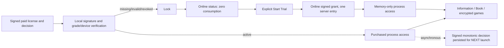

# YariZan V2 — Phase 1 engineering report

Date: 2026-10-14. Desktop foundations implemented on an isolated feature branch for independent review. **Phase 1's complete release/acceptance gate is not met:** real backend enrollment/issuance and production public trust roots are blocked, and real disconnected endurance/reboot/multiple-account/installer validation remains unexecuted.

## A. Repository state

- Branch: `feat/yarizan-v2-device-licensing`.
- Base/latest main at mission start: `aef9bbc78d0a9a4357c3625f56b77ad037f672f7`.
- The final SHA is provided with the final handoff; a report cannot contain its own Git commit hash. [Draft PR #1](https://github.com/osameh15/YariZan/pull/1) is review-only. Implementation/test revision before documentation: `eb6b980` plus the settled-screenshot and TPM-less runner follow-ups.
- Commits: `2fbbb51` source review/plan; `1e288ae` core foundations; `4d1cf9f` WPF integration; `3b25596` authenticated recovery/key injection; `eb6b980` deterministic/Windows/HTTP/WPF tests; followed by settled-screenshot and artifact-profile/report commits. Use `git log --reverse aef9bbc..HEAD` for the authoritative complete list.
- No main merge, release tag or deployment. PR is review-only. Existing licensing deployment workflow and its watched paths are untouched.

## B. Architecture

`YariZan.Core.V2` contains shared device identity, CNG challenge signing, strict artifact verification, DPAPI atomic storage, access policy and bounded HTTP client. `DesktopAccessFactory` composes release dependencies; tests inject disposable keys/server responses. `MainWindow` owns one access controller and launcher for the application process. Legacy Core helpers remain for SerialGen and isolated historical regression tests but are not WPF authorization dependencies.

Interfaces: `IDeviceIdentity`, `IDeviceFingerprintProvider`, `IDeviceKeyStore`, `ILicenseVerifier`, `ILicenseStore`, `IAccessPolicy`, `ITrialStartClient`, `ILicenseSyncService`, `IDesktopV2Client`, `IDeviceCredentialProvider`, `IDeviceRegistrationClient`.

| State | Entry/game access | Network behavior |
|---|---|---|
| NoLicense | Locked | Status/start/pickup only |
| Purchased | Immediate local access | Optional nonblocking startup sync |
| Revoked | Paid locked | Explicit authenticated recovery; trials subject to backend policy |
| TrialAvailable | Locked until click | Status never consumes |
| TrialStarted | Local process access | No request, heartbeat or expiry |
| TrialExhausted | Locked | Purchase/recovery needed |
| ConnectionUnavailable | Locked | Visible Lock retries status |
| ActivationPending | Locked during explicit pickup | Cancellable online operation |
| InvalidLicense | Locked | No corrupt-file fallback |
| EnrollmentRequired | Locked | No HWID-only fallback |
| Closed | Denied | Lifetime cancellation, games stopped and cleaned |

Fingerprint v2 hashes normalized fixed-order WMI UUID/board/BIOS/CPU signals. It is grade/path/process/user independent. MachineGuid is the all-WMI-unavailable fallback; complete failure reports unavailable identity. Username uses 96 public digest bits in grouped hex; no raw hardware IDs are displayed. Backend-issued device UUID and enrolled credential remain separate from the username. Actual six grade configurations and six separate processes on this Windows machine produced the same username (not logged).

CNG uses persisted per-user P-256 signing keys, non-exportable, TPM preferred with software KSP fallback. Non-admin TPM and software operations were both executed; reopening across processes succeeded. Keys/entitlements are not automatically shared across Windows accounts. No unsafe machine permissions were granted. Self-created keys prove key possession, not physical hardware authenticity.

Artifact details are frozen in [ADR-0004](adr/0004-phase-1-desktop-artifact-profile.md): RFC8785 bounded safe-integer I-JSON subset, strict fields, pinned kid, P-256/SHA-256, 64-byte IEEE P1363 and separate paid/trial/decision domains. Paid licenses require device UUID, fingerprint v2/digest, grade+SKU, perpetual null expiry and positive license_revision. Verification never gates paid/trial access on the clock. All private server signing keys stay outside the app; tests generate ephemeral keys in memory.

Local `%LOCALAPPDATA%/OARNOVA/YariZan/V2/` stores one DPAPI CurrentUser paid license and decision per SKU. Profile ACLs and DPAPI supplement signatures. Exclusive same-SKU file locks serialize writes; write-through/flush and atomic replace avoid truncated overwrites. Missing/corrupt/truncated/malformed state fails safely; orphaned temporary writes do not replace previously valid entitlements. Signed decisions are reverified on restart and protected by increasing decision revisions while official code runs.

Trial creates one random process UUID and 256-bit nonce per controller. A lost response retries the same request. Only a verified correctly bound start grant changes State to TrialStarted. No reusable grant is stored, no timer or per-game network check exists, and window/process shutdown ends access. A new OS process was unable to recover the active grant. Fake server transactions prove the **client contract**, not production server quota enforcement.

HTTP uses only the future V2 host; no PHP fallback. App disables redirects and cookies. Requests support cancellation, 15-second operation deadlines, bounded UTF-8 request/response bodies and structured failures. Only unloaded/cancelled Lock performs status retries. Paid sync runs on Task.Run, validates signature/target/revision and atomically persists decisions without changing ongoing access. Explicit user recovery requires a newer signed ACTIVE decision for the same license. Cross-license-ID reissue is blocked until its migration contract is defined.

## C. File-by-file implementation

| File | Change and purpose |
|---|---|
| `src/YariZan.Core/V2/DeviceIdentity.cs` | Versioned public identity, deterministic normalization, WMI/registry abstraction |
| `src/YariZan.Core/V2/DeviceKeyStore.cs` | TPM-preferred user-scoped CNG persistence/public export/challenge signing |
| `src/YariZan.Core/V2/CanonicalJson.cs` | Strict bounded JSON, RFC8785 subset and canonical base64url |
| `src/YariZan.Core/V2/SignedArtifacts.cs` | Product/claim models; strict paid/trial/decision verification |
| `src/YariZan.Core/V2/LicenseStore.cs` | Six-grade DPAPI storage, atomic publication and writer locks |
| `src/YariZan.Core/V2/DesktopAccessController.cs` | Central access states, process-only trial, nonblocking sync and explicit recovery |
| `src/YariZan.Core/V2/DesktopV2Client.cs` | V2 routes, bounded cancellable transport, enrolled credential and blocked registration boundaries |
| `src/YariZan.Core/YariZan.Core.csproj` | ProtectedData 9.0.0 dependency |
| `src/YariZan.App/Services/DesktopAccessFactory.cs` | Release composition, embedded public roots and unprovisioned credentials |
| `src/YariZan.App/Services/OnlineTrialClient.cs` | Deleted: removes active legacy PHP authorization client |
| `src/YariZan.App/Views/MainWindow.xaml.cs` | Local navigation/game gates, no heartbeat, startup sync, shutdown lifetime; injectable game-key loader for synthetic integration |
| `src/YariZan.App/Views/LockPage.xaml.cs` | Common username, explicit trial/pickup, cancellable Lock-only status retry |
| `src/YariZan.App/Views/LockPage.xaml` | Persian V2 policy/support copy and pickup action; removes v1 serial input |
| `src/YariZan.App/Views/InfoPage.xaml.cs` | Clarifies future trial starts and current offline process access |
| `src/YariZan.App/YariZan.App.csproj` | Conditional reviewed public-key map embedding; fixture option excludes game AES key |
| `tests/V2Checks/V2Checks.csproj` | Windows/WPF executable test harness referencing actual app/Core |
| `tests/V2Checks/Fixtures.cs` | Disposable signer, mock WMI, transactional fake server with lost-response simulation |
| `tests/V2Checks/Program.cs` | Crypto/state/storage/HTTP/CNG/process/WPF integration checks and screenshot |
| `tests/V2Checks/interop.mjs` | Node canonical-byte comparison, .NET verification and reverse signing with an ephemeral key |
| `tests/Run-V2Checks.ps1` | Synthetic game build and repeatable isolated V2 suite |
| `tests/Run-BookChecks.ps1` | Generates synthetic portrait; avoids private game artwork/key dependency |
| `.github/workflows/ci.yml` | V2 Windows checks, Node interoperability and pinned OpenAPI lint; no deploy step added |
| `docs/YARIZAN-PHASE-1-PLAN.md` | Source-based plan written before code changes |
| `docs/adr/0004-phase-1-desktop-artifact-profile.md` | Exact implemented identity/crypto/storage/protocol refinements and gates |
| `docs/YARIZAN-API-CONTRACTS-V2.md` | Reconciles paid fields/UUIDs/revisions and enrollment blocker |
| `docs/YARIZAN-OPENAPI-V2.yaml` | Typed strict paid/trial/sync envelopes; resolves baseline lint defects |
| `docs/YARIZAN-IMPLEMENTATION-ROADMAP-V2.md` | Reports implemented foundations and unmet exit gates |
| `README.md` | Feature-branch desktop status and release blockers; historical access labeled |
| `docs/architecture.md` | Legacy architecture explicitly archived; links current report |
| `docs/security.md` | Legacy security explicitly archived; links current report |
| `docs/ui-flow.md` | Legacy flow explicitly archived; links current report |
| `docs/build-and-pack.md` | V2 distribution gates and safe fixture-only build options |
| `docs/ci.md` | New suites and synthetic inputs documented |
| `docs/Images/phase1-lock-v2.png` | Settled WPF Lock snapshot using test-only identity/server state |
| `docs/YARIZAN-PHASE-1-REPORT.md` | This review/evidence report |

Intentional incompatibilities: old HWID-only serials/activation.dat cannot unlock V2, no grade-wide migration, old PHP endpoint is not a V2 API, and serial entry becomes authenticated license pickup. Packer/game blob/manifest formats and unrelated launcher/book features are unchanged. ADR refinements: add paid device_id; freeze signed decision format/domain; specify integer-only JCS subset, UUID/timestamp profile, fingerprint normalization and user scope. Business rules are preserved.

## D. Testing and evidence

Environment: Windows NT `10.0.26300.0` x64, non-elevated Windows token; .NET SDK `10.0.401` compiling `net9.0-windows`, runtime `.NET 9.0.20`; Node `v24.20.0`; Windows PowerShell. Redocly CLI `2.63.0`.

| Executed command | Exact final result |
|---|---|
| `dotnet build src/YariZan.sln -c Release -p:IncludeGameBundle=false -p:IncludeGameKey=false --no-restore --nologo` | Success, 0 warnings, 0 errors; four projects |
| `.\tests\Run-V2Checks.ps1` | **117 passed, 0 failed** |
| `.\tests\Run-AccessChecks.ps1` | **27 passed, 0 failed**; historical utilities only |
| `.\tests\Run-LauncherChecks.ps1` | **8 passed, 0 failed**; invisible synthetic encrypted game |
| `.\tests\Run-GradeChecks.ps1` | **5 reported acceptance groups passed, 0 failed**; invalid CLI exits intentionally exercised |
| `.\tests\Run-BookChecks.ps1` | **36 passed, 0 failed**; synthetic portrait |
| `py tools/Check-PublicRepository.py` | Passed: no tracked private runtime files/signing keys |
| `npx --yes @redocly/cli lint docs/YARIZAN-OPENAPI-V2.yaml` | Passed, 0 errors/warnings with CLI 2.63.0 |
| `git diff --check` | Passed |

Total final assertion/acceptance groups across suites: **193 passed, 0 failed**. OpenAPI/scanner/build are additional checks, not added to that assertion total. New suite reruns occurred only after substantive test/recovery/screenshot/provider changes. Initial restore failed due to inherited malformed proxy settings; clearing HTTP_PROXY/HTTPS_PROXY/ALL_PROXY for the restore process allowed it to succeed. No machine proxy configuration was changed.

First PR CI run (Windows Server 2025 hosted VM) passed restore/build/scanner/legacy suites but stopped after 95 V2 passes in CNG setup; cleanup masked the original provider error. The implementation unnecessarily probed TPM even in a software-only creation path. Follow-up removes that dependency, handles TPM-less fresh creation, persists per-user provider choice so established-key loss fails closed, and avoids cleanup masking. Local rerun passes 117 checks; the final handoff records the subsequent remote CI result separately. This adds a recorded-provider/key-loss rejection test.

Earlier development runs failed on harness compile errors, an uncaught invalid sync artifact, and a reflection-driven WPF game click lacking a dispatcher synchronization context. Those were corrected and the final run passed. The test snapshot explicitly settles page animation because off-screen HWNDs do not necessarily advance composition. No failure is hidden as a skipped test.

Executed Windows evidence includes actual WMI across six grade configurations and six separate OS processes; non-admin software and TPM CNG sign/export-rejection/reopen; paid signed store and revocation checks in child OS processes; trial restart rejection in another OS process; WPF Cover/Lock/Information/Book navigation and two encrypted synthetic game launches with disconnected test transport, loading-overlay restoration and decrypted-file cleanup on shutdown. Other suites exercise page turns, RTL titles, thumbnails/cache/corruption, numerical navigation, game cancellation and generation-counter shutdown protection.

Crypto evidence: .NET P1363 signed paid artifact verified by Node; Node generated a fresh disposable key and signed the same payload, accepted by .NET. Canonical Unicode/Persian/control/emoji/U+2028/safe-integer bytes matched. Wrong grade/device, altered payload, bad/short signature, unknown key, duplicate fields, invalid claims and domain substitution reject. Sync tests cover forged/wrong-target/stale/equal revisions, next-launch revocation, corrupt state and higher authenticated recovery.

Trial evidence: status consumes zero; lost HTTP response consumes one but does not grant local access; exact nonce/process retry returns the grant without another entry; concurrent UI calls consume once; ten distinct parallel starts yield exactly two successes in the locked **fake**; G2 counters are independent. Active process access stays local at modeled elapsed checkpoints and actual WPF game switches invoke zero new requests. There is no clock/lease dependency. **This is not a real one-hour test.**

Not executed: physical all-network disconnection for 60+ minutes, real backend activation/trials, real PostgreSQL contention/retention, Windows reboot/reinstall, second Windows account, TPM removal/loss, six built installers/clean installation, authentic production game assets and real server key rotation. The workstation was not rebooted, reconfigured or disconnected; no production data/keys/games were used for tests. No installer/commercial-release claim is made. Remote GitHub CI results, if available, are separate from local results.

Screenshot: [V2 Lock with test identity](Images/phase1-lock-v2.png). Other local regression renders are under ignored `publish/`; no real game artwork was required.

## E. Requirement matrix

Implemented means executable desktop behavior verified where stated; it never implies deployed backend or completed physical endurance. This matrix covers mission sections 1–11; reporting and safety are sections A–H here.

| Requirement | Classification | Evidence/remaining scope |
|---|---|---|
| Read twelve latest-main docs and legacy architecture/security/UI/build/tests | Implemented | Source plan before edits, base recorded |
| Inspect all four projects and every named access/launcher path | Implemented | Graph search/trace/snippet plus coverage checks and source reads; metadata changes qualified |
| Separate feature branch, incremental commits, no merge/deploy | Implemented | Repository history and safety check |
| Shared versioned fingerprint independent of grade/path/executable/process | Implemented | Shared Core implementation; six separate Windows configurations/processes |
| Hardware normalization and mock WMI boundaries | Implemented | Case/whitespace/NFKC/placeholders/order/partial WMI tests |
| Human-readable common username; no unnecessary raw identifiers | Implemented | WPF username, no raw WMI logs/network data |
| Distinguish fingerprint/username/device ID/authentication credential | Implemented | Separate interfaces and signed backend UUID claims |
| Stable internal backend UUID enrollment/storage | Partially Implemented | UUID carried in signed licenses/credential boundary; actual enrollment blocked |
| CNG TPM preference, secure software fallback, non-admin operation | Implemented | Both providers tested with non-elevated token |
| Reopen persisted user-scoped non-exportable key | Implemented | Separate-process tests; no unsafe ACL/MachineKey |
| Reboot/reinstall/cross-Windows-user stability | Partially Implemented | Algorithm user independent; physical/account scenarios not executed |
| Challenge-signing foundation | Implemented | Signed proposed transcript tested; no claim of attestation |
| Secure device registration/pairing/account claim | Blocked | Reviewed enrollment/anti-first-claim race and backend required |
| Exactly one device and SKU/grade per perpetual purchased artifact | Implemented | Strict signed ID/fingerprint/SKU/grade fields and rejection tests |
| P-256/SHA256/JCS/domain/P1363/kid/version verification | Implemented | .NET/Node checks and negative crypto tests |
| Production signing private key never shipped/tested/generated | Implemented | Ephemeral fixture keys, pinned public-root boundary, scanner |
| Initial authenticated activation/pickup end to end | Blocked | Future backend, enrolled credential and reviewed production trust roots absent |
| Local paid immediate offline launch and restart | Implemented | Core/WPF and actual child-process signed-store tests |
| Network timeout/outage cannot terminate valid paid games | Implemented | Local CanEnter, hanging/failing sync tests; no stop path on networking |
| Async startup sync never blocks entry/gameplay | Implemented | Entire sync scheduled; local WPF entry and hanging sync tested |
| Signed target-bound monotonic revocation, atomic persistence | Implemented | Signature/target/revision rejection and protected-store tests |
| Revocation affects next launch, not ongoing session | Implemented | Controller and child-process/HTTP tests |
| Higher signed ACTIVE recovery for same license | Implemented | Explicit recovery tests; outage/stale ACTIVE denied |
| Cross-license-ID reissue/migration | Blocked | Authenticated migration contract needs backend/security review |
| Permanently offline remote revocation limitation | Implemented | Documented, no mandatory lease introduced |
| Trial status lookup never consumes | Implemented | Fake server and HTTP/WPF status tests |
| Explicit online Start Trial consumes one verified grant | Partially Implemented | Client and WPF/HTTP fake verified; live server not implemented |
| Two per-device/per-grade authoritative entries | Partially Implemented | Locked transactional test transport; PostgreSQL enforcement blocked |
| Random nonce and exact lost-response retry idempotency | Implemented | Fake and HTTP lost-after-commit/retry tests |
| Concurrent starts cannot exceed two | Partially Implemented | Ten-way locked fake test; production DB races not implemented |
| Active trial no online continuation, time limit or heartbeat | Implemented | Local state, no clock/expiry, no MainWindow timer; disconnected transport WPF two-game test |
| Game switches/pages spend no extra entry/revalidation | Implemented | Actual WPF navigation and two encrypted synthetic launches |
| Full exit ends trial; fresh process needs new online start | Implemented | Window shutdown and separate OS-process tests |
| No persisted reusable trial credential | Implemented | No trial store writes; independent process remains locked |
| Real 60+ minute complete-disconnect endurance | Not Started | Explicitly unexecuted physical acceptance gate |
| Central states: all mission paid/trial/connection/activation/corrupt cases | Implemented | Controller enum/policy, WPF uses same decision |
| Cover/Lock/Info/book/animation/thumbnails/loading/RTL retained | Implemented | 36 book checks plus WPF V2 tests |
| Encrypted game preparation/cancellation/shutdown preserved | Implemented | 8 launcher checks plus WPF synthetic integration |
| Six independent durable product entitlements | Implemented | Six store slots validated without overwrite |
| Missing/corrupt/truncated/malformed storage safely rejected | Implemented | Protected-store, schema and decision failures |
| Atomic writes/interrupted-write safe recovery | Implemented | Replace/no-temp and abandoned-temp tests; no real power-cut test |
| Appropriate Windows storage/permissions, no signer private key | Implemented | User-profile DPAPI and signature defense in depth |
| Revocation separate from transient network health | Implemented | Separate signed decision vs LastError/state tests |
| Rollback/process/executable tamper limitations documented | Implemented | ADR/report; no tamper-proof claim |
| V2 host/interfaces for trial/pickup/sync | Implemented | Route/DTO HTTP tests; no PHP client remains |
| Device challenge/registration endpoints | Partially Implemented | Typed interfaces/key foundation; production implementations blocked |
| Cancellation/timeouts/payload bounds/errors | Implemented | Cancellable bounded transport and tests |
| Valid paid works when V2 unavailable; unlicensed remains locked | Implemented | Offline paid / unprovisioned enrollment tests |
| Cross-language serialization/signature checks | Implemented | Node/.NET bidirectional disposable key checks |
| Existing packaging/launcher/book/access regressions | Implemented | Final suite counts above |
| Six clean grade installers and real encrypted game release | Not Started | No production asset/installer work authorized in this phase |
| Production/staging/DB/DNS/payment/SMS changes prohibited | Implemented | None made; future commercial platform not started |
| Complete Phase 1 definition of done/release gate | Partially Implemented | Desktop verified; backend/physical/installer acceptance gaps remain |

## F. Security review

Device spoofing/enrollment: fingerprint and public username are not secrets. CNG prevents ordinary private export and raises casual-copy costs; software provider/VM cloning remain vulnerable. TPM possession is not attestation. First anonymous enrollment and claim races are unresolved and deliberately unavailable in the stock build. Browser/account/support recovery must never authorize from HWID alone.

License tampering: strict schemas and pinned public roots protect official verification against forged/cross-grade/cross-device artifacts, signature encoding ambiguity and JSON ambiguity. DPAPI is not the trust source. The executable and bundled AES game key remain customer-controlled; code patching/content extraction remain possible.

Revocation: only signed matching increasing decisions persist; network failure never revokes. Corrupt learned state locks rather than pretending to clear revocation. A full local backup rollback or deletion can remove learned decisions; no permanent offline revocation guarantee exists. No ongoing paid game is forcibly closed when a revocation is learned.

Trial replay: random process/nonce and memory-only gate stop ordinary official-client relaunch reuse. Duplicate lost-response retry is idempotent. Modified binaries, snapshots and prolonged open processes can bypass business limits; no claim of tamper-proof quota is made. Counters must be server authoritative; the test fake is not distributable enforcement.

Secret review: no new production secrets, private signing keys, gateway settings, credentials or game payloads were committed. Public roots are compile-time reviewed data. Test private keys are generated in memory; CNG test keys are uniquely named and deleted after checks. Tests build encrypted fixtures using random disposable AES keys and disable real game/key inclusion. Public repository scanner passed. No real customer identifiers are in the report/screenshot.

## G. Known issues and required next steps

1. **Release blocker:** secure enrollment/device credential issuance, registration anti-race controls and account pairing require backend/security design. Production implementation intentionally returns EnrollmentRequired.
2. **Release blocker:** provision reviewed V2 public verification roots and server-only signing custody/backup/rotation; no test roots may become release roots. New builds currently cannot perform commercial activation/trial.
3. **Backend gate:** implement PostgreSQL per-device/product counters, retained nonce transactions, exact signed artifacts, pickup and synchronization; run real client/server contract and contention tests.
4. **Physical gate:** execute 60+ minute trial with all connectivity removed, real reboot/offline paid restart, multiple Windows accounts, OS reinstall, hardware changes/TPM loss and six clean installer configurations. No guarantees beyond observed machine/process evidence.
5. **Recovery gate:** same-ID signed ACTIVE recovery is implemented; cross-ID reissue and corrupt-state recovery need authenticated migration without silently erasing signed revocation.
6. **Release integrity:** clean fixture-only build does not prove production installer/content/AuthentiCode/signing/public-key configuration. Existing manifest/content trust and game-key extraction limitations remain.
7. No remaining failures in executed local suites. Full Phase 1 sign-off remains partial for the gates above. Stop for independent review; do not merge or deploy.

## H. Explicit safety confirmation

| Protected target | Modified? |
|---|---|
| Production/staging services | **No** |
| Main branch | **No** |
| DNS/shared VPS infrastructure | **No** |
| Live databases / PHP/MySQL service | **No** |
| Existing PHP licensing deployment/workflow | **No** |
| Production signing keys | **No** |
| Real payments/ZarinPal/MeliPayamak | **No** |

Only desktop/test/documentation/desktop-CI files on the feature branch were changed. No deployment workflow was dispatched. No production game payloads, credentials or signing keys were used for test scenarios. No merge/deployment approval is assumed.
