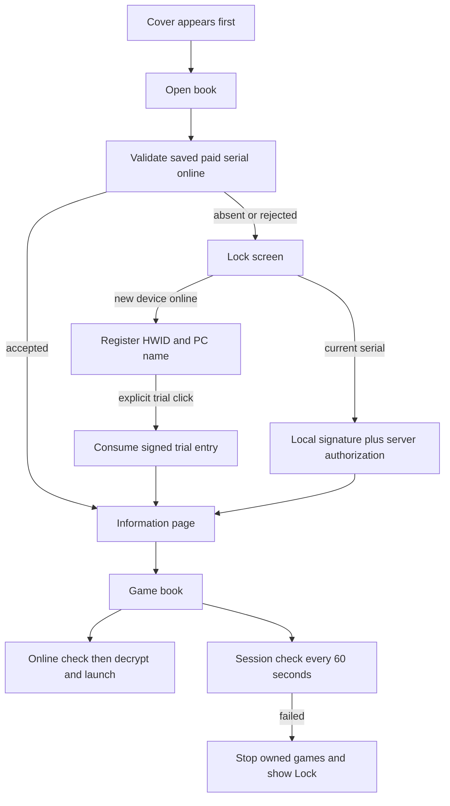

# Architecture

> **V2 planning notice (2026-10-14):** This document records the **currently implemented legacy 1.1.0** behavior, not the approved future licensing policy. The previous release has not been commercially launched and the V2 design does **not** require protocol/data backwards compatibility. **V2 is not implemented.** Follow the [V2 specification](YARIZAN-TECHNICAL-SPEC-V2.md), [data model](YARIZAN-DATA-MODEL-V2.md), [API contracts](YARIZAN-API-CONTRACTS-V2.md), and [roadmap](YARIZAN-IMPLEMENTATION-ROADMAP-V2.md) for the planned Nuxt/NestJS/PostgreSQL offline-first platform. Current code still requires online authorization for both paid and trial; V2 paid use will be offline and V2 trial will require internet **only for session start**.

YariZan combines a Windows WPF launcher, local game packaging tools, and a PHP/MySQL licensing service. Games ship with the desktop; the host stores device state and signs authorization proofs.

## Modules

| Module | Responsibility |
|---|---|
| `YariZan.App` | Persian views/resources, navigation and online client |
| `YariZan.Core` | HWID, serial/grant verification, activation/session state, game crypto/launching/sorting |
| `YariZan.Packer` | Encrypt source executables, copy thumbnails, write manifest |
| `YariZan.SerialGen` | New key initialization and local diagnostics |
| `web/licensing/public` | Login/admin, assets, API; public document root |
| `web/licensing/app`, `bin`, `database` | Private PHP implementation, CLI maintenance/migrations, SQL |
| `tools` / workflows | Bundles, private preparation, checks, public FTPS uploads |

## Runtime flow

`MainWindow` owns the online client, in-memory `AccessSession`, game library, launcher and heartbeat. Protected navigation depends on an authorized session, never on saved activation alone. `LockPage` retries a saved paid serial before trial registration. Outages retain the paid record for recovery.

`OnlineTrialClient` uses HTTPS JSON POST, disabled redirects, a 15-second timeout, and bounded responses. A process retains its trial consumption nonce for idempotent retries; each authorization check has a fresh nonce. PHP/C# agree on exact signed messages and raw P-256 signatures.

## Games and keys

Local games reside directly in grade folders `miniApps/1` through `6`. Each package contains one grade: automatically select the only populated source folder, or pass an explicit grade when several contain games. The manifest records `SelectedGrade`, used for the title and game filtering. Packing produces external manifest/blobs/thumbnails in `games_encrypted/`, copied beside the app. Numeric filename chunks sort naturally. Each spread contains twelve portrait tiles, three columns by two rows per page, first page on the right. Editable spread navigation supports Persian, Arabic and English digits.

The book snapshots its sorted games once. Thumbnail decoding uses two background workers, a 360-pixel decode height and a bounded 48-entry cache; frozen bitmaps are assigned on the UI dispatcher. A 370 ms spine-centered fold/unfold animation runs while incoming thumbnails decode in the background; overlapping navigation and game clicks during turns are blocked. Installer names, output directories and shortcuts use `YariZan G<grade>`; licensing remains shared by HWID across grades.

The app embeds its public signing key and AES master key. The server retains the matching private key outside the document root. The launcher decrypts to restricted temporary directories, owns started processes, and attempts cleanup on exit; revocation stops owned processes. See [protection limits](security.md#limitations).

## Server and deployment

MySQL stores metadata, current serials, trial usage/grants, rate limits, audit events and blocked HWIDs. Transactions serialize consumption and retained nonces support retries. Removing a device deletes details/grants/audit rows and keeps a blocked HWID to stop automatic recreation. Explicit admin issuance restores it. Regeneration replaces serial, revokes trial grants and exhausts trials.

Public FTPS deploy changes public files only. Private code/schema updates and credential/key provisioning are uploaded manually. See [hosting](../web/licensing/README.md) and [CI](ci.md).

Game launching runs preparation off the UI thread. The launcher synchronizes process registration with revocation using a generation counter; stopped/disposed launchers cannot register a late prepared process. Cancelled/failed preparation clears plaintext and cleans temporary files. MainWindow owns the loading overlay and cancellation source, waits for a ready game window, and restores UI interaction in a finally block.
